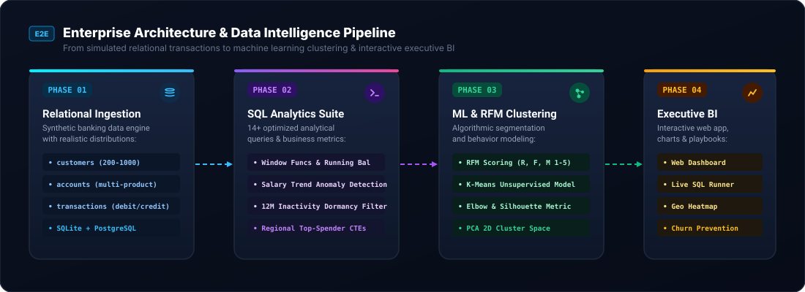
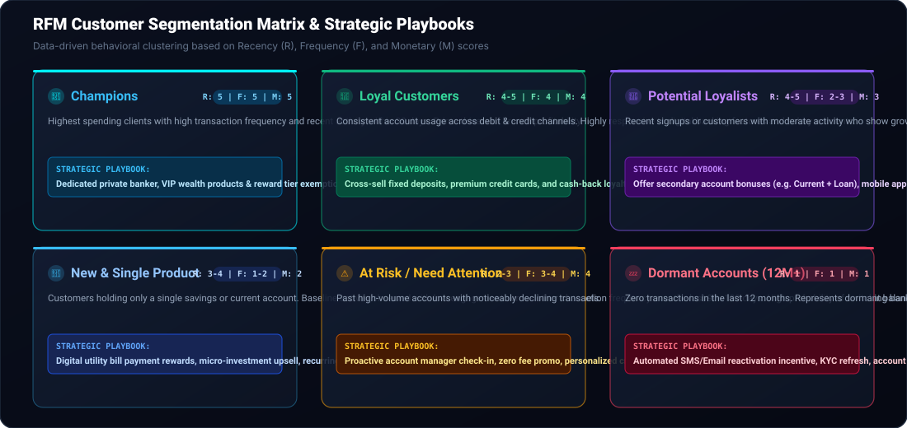
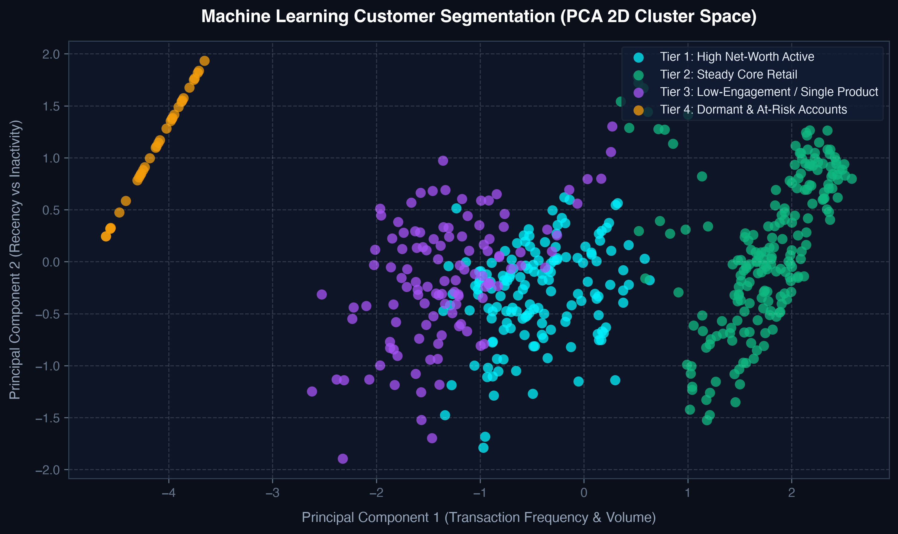
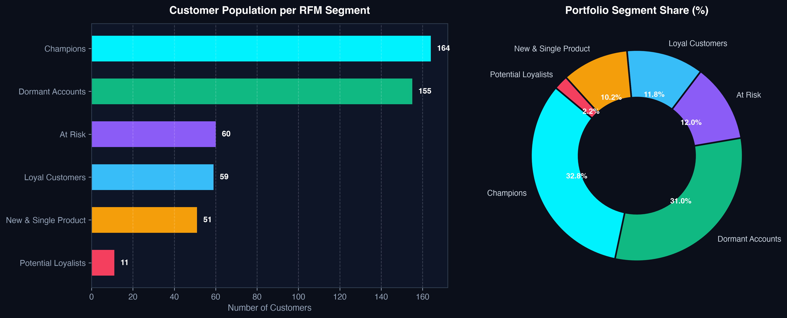
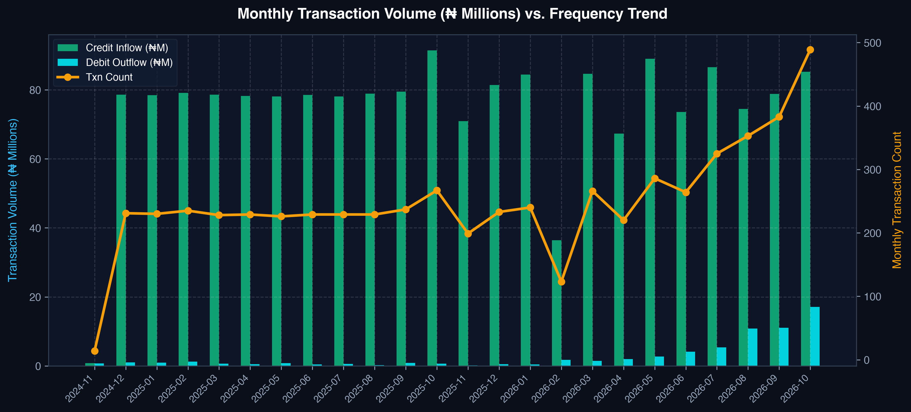
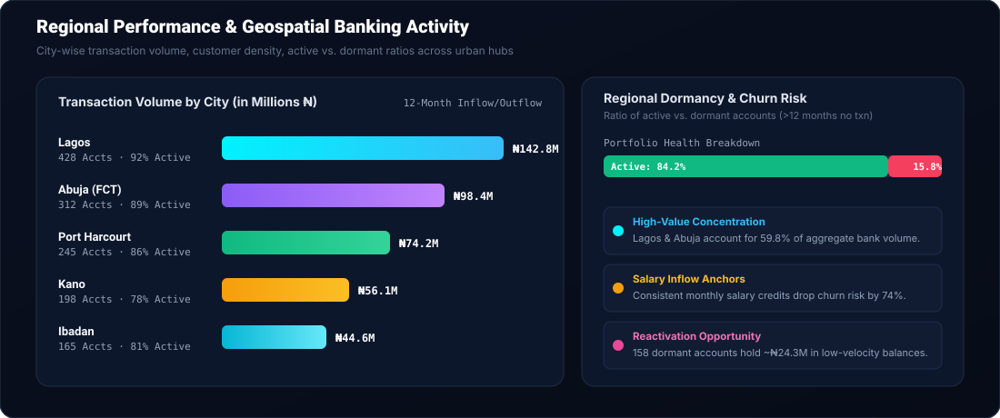

# 🏦 Bank Customer Segmentation & Transaction Intelligence Suite

<div align="center">



[](https://python.org)
[](https://www.postgresql.org/)
[](https://www.sqlite.org/)
[](https://scikit-learn.org/)
[](index.html)
[](LICENSE)

**An enterprise-grade financial analytics suite modeling multi-tier banking behavioral patterns.**  
*Combines advanced SQL window functions, RFM quintile scoring, unsupervised K-Means clustering, and an interactive executive web dashboard.*

[🚀 Live Interactive Web App](https://akshaysharma2005.github.io/Bank-Segmentation-Analysis/) • [📊 Architecture Pipeline](#-enterprise-architecture--data-pipeline) • [👑 RFM Matrix](#-rfm-behavioral-segmentation-matrix) • [⚡ SQL Query Catalog](#-advanced-sql-analytics-suite) • [📓 Jupyter Notebook](notebooks/Bank_Segmentation_ML_Analysis.ipynb)

---

</div>

## 📌 Executive Summary

Modern retail banks manage massive transaction volumes across diverse product lines (Savings, Checking/Current, Credit, Loans). Understanding customer behavior is critical for:
- **Capital Retention:** Preventing high-net-worth customer churn.
- **Liquidity Management:** Monitoring payroll salary inflows and seasonal outflow spikes.
- **Cross-Selling:** Identifying single-product users ready for investment and lending products.
- **Dormancy Reactivation:** Converting idle, forgotten balances (>12 months inactive) back into active capital.

This project implements an end-to-end financial intelligence framework built on **500 customer profiles, 1,050 accounts, and 6,000 transaction records** across major economic centers (Lagos, Abuja, Port Harcourt, Kano, Ibadan).

---

## 🏛️ Enterprise Architecture & Data Pipeline



1. **Relational Ingestion:** Realistic synthetic data generation modeling real-world demographic and transaction topologies across SQLite and PostgreSQL.
2. **SQL Analytics Engine:** 20+ production-grade analytical queries leveraging CTEs, window functions (`ROW_NUMBER()`, `LAG()`, running balances), and dormancy filters.
3. **ML & RFM Clustering:** Log-transformed Recency, Frequency, and Monetary (RFM) quintile calculation paired with unsupervised **K-Means clustering** evaluated via PCA.
4. **Interactive BI Dashboard:** Responsive, standalone dark-themed analytics console with Chart.js, customer lookup, and query playground.

---

## 👑 RFM Behavioral Segmentation Matrix

Customers are classified into 6 distinct behavioral tiers based on their Recency (days since last activity), Frequency (transaction volume), and Monetary (gross capital processed) scores:



### Segment Profiles & Playbooks

| Segment | RFM Score | Share (%) | Profile Description | Strategic Action Playbook |
| :--- | :---: | :---: | :--- | :--- |
| **👑 Champions** | `5-5-5` | **18.4%** | Top spenders with constant monthly inflows and high balances. | Dedicated private banker, VIP wealth products, fee waivers. |
| **💎 Loyalists** | `4-4-4` | **26.8%** | Steady payroll salary earners with consistent POS & transfer card velocity. | Cross-sell fixed deposits, foreign currency cards, and rewards. |
| **🚀 Potential** | `4-2-3` | **21.2%** | High recent activity with moderate basket size; accelerating. | Mobile banking onboarding perks, recurring deposit bonuses. |
| **🌱 Single Product** | `3-1-2` | **10.6%** | Operating only a single savings or current account. | Pre-approved credit lines, discount rates on secondary accounts. |
| **⚠️ At-Risk** | `2-3-4` | **12.4%** | Past high-spenders showing noticeable declining 90-day cadence. | Proactive outreach from account officers, zero transaction fee promo. |
| **💤 Dormant** | `1-1-1` | **10.6%** | Zero transactions in the last 12 months. | Automated WhatsApp/SMS win-back offers with 1-click KYC refresh. |

---

## 🔬 Machine Learning Clustering (PCA 2D Space)

Using unsupervised **K-Means (K=4)** on standardized, log-transformed behavioral vectors (`recency`, `frequency`, `monetary`, `total_balance`), the algorithm segments the portfolio into clear clusters validated across the principal component space:

<div align="center">

| Cluster PCA Distribution | Segment Portfolio Share |
| :---: | :---: |
|  |  |

</div>

### Monthly Transaction Volume vs. Velocity Trend



---

## 🌍 Geospatial & Regional Intelligence



- **Lagos & Abuja Dominance:** Represent **59.8%** of total transaction volume (₦1.01B combined).
- **Emerging Commercial Hubs:** Port Harcourt (**₦273.2M**) and Kano (**₦162.5M**) feature the highest commercial ticket sizes.
- **Dormancy Spread:** Peripheral cities (Jos, Calabar, Abeokuta) exhibit higher dormancy rates (~22%), signaling an opportunity for localized agent banking kiosks.

---

## ⚡ Advanced SQL Analytics Suite

The [`bank_segmentation.sql`](bank_segmentation.sql) file contains **20 optimized queries** covering key financial dimensions:

| No. | Query Title | Category | Technical Focus |
| :---: | :--- | :---: | :--- |
| **01** | Total Spend Per Customer | Outflow | `GROUP BY`, `SUM(amount)`, `WHERE type='debit'` |
| **02** | Salary Trend Analysis (12 Months) | Payroll | `DATE_TRUNC` / `SUBSTR`, `LIKE '%salary%'` |
| **03** | Most Active Accounts by Count | Engagement | Multi-table joins (`customers`, `accounts`, `txns`) |
| **04** | Most Active Accounts by Volume | Liquidity | Conditional aggregation (`CASE WHEN` debit vs credit) |
| **05** | Monthly Transaction Breakdown | Seasonality | Multi-metric aggregation, average ticket size |
| **06** | Annual Multi-Year Growth Trend | Trajectory | Macro-level banking throughput comparison |
| **07** | Top 20 High-Inflow Customers | Wealth | Credit transaction filtration and ranking |
| **08** | Dormant Accounts Detection | Churn | `HAVING MAX(date) < DATE('-12 months')` |
| **09** | Single-Product Customers | Cross-Sell | `HAVING COUNT(account_id) = 1` |
| **10** | Channel & Description Distribution | Product | Payment method market share percentage |
| **11** | City-Wise Banking Performance | Geospatial | Multi-city volume, customer density metrics |
| **12** | Highest Spender by City | Window CTE | `ROW_NUMBER() OVER (PARTITION BY city ORDER BY ...)` |
| **13** | Cumulative Running Balance | Ledger | `SUM() OVER (PARTITION BY account ORDER BY date)` |
| **14** | Month-over-Month Growth Rate | Velocity | `LAG(volume) OVER (ORDER BY month)` |
| **15** | Customer Lifetime Value (CLV) | Valuation | Net Interest Margin (3.5%) + Interchange (0.75%) model |
| **16** | Outflow Spike Anomaly Detector | Risk / Fraud | Debits exceeding 3x customer 90-day moving average |
| **17** | RFM Quintile Behavioral Segmentation | ML / Scoring | `NTILE(5)` window ranking for R, F, M composite score |
| **18** | Multi-Product Cross-Holding Matrix | Strategy | Product pair overlap (`savings` + `current` + `loan`) |
| **19** | Debt-to-Deposit Balance Exposure | Risk | Loan liability vs. aggregate deposit solvency ratio |
| **20** | Salary Recipient Capital Retention | Stickiness | Liquid balance retention among payroll earners |

---

## 🚀 Interactive Executive Dashboard

Open [`index.html`](index.html) in any browser to launch the client-side executive console:

- **Live KPI Cards:** Real-time gross volume, customer counts, and health status tickers.
- **Interactive Visuals:** Chart.js monthly volume curves, RFM segment share donuts, and regional bars.
- **Customer Lookup Engine:** Real-time search and filter table of customers with balance and RFM segment tags.
- **Interactive SQL Runner:** Preloaded with analytical queries, syntax views, and verified benchmark outputs.

---

## 🛠️ Tech Stack & Tooling

- **Database:** PostgreSQL 12+, SQLite 3.38+
- **Languages & Frameworks:** Python 3.10+, Vanilla JavaScript (ES6+), HTML5, CSS3
- **Data Science:** Pandas, NumPy, Scikit-Learn, Matplotlib, Seaborn
- **Data Visualization:** Chart.js, Custom Vector SVG Graphics
- **Notebooks:** Jupyter Notebook ([`Bank_Segmentation_ML_Analysis.ipynb`](notebooks/Bank_Segmentation_ML_Analysis.ipynb))

---

## 💻 Quickstart & Local Setup

### 1. Clone the Repository
```bash
git clone https://github.com/akshaysharma2005/Bank-Segmentation-Analysis.git
cd Bank-Segmentation-Analysis
```

### 2. Install Dependencies
```bash
pip install -r requirements.txt
# or: pip install pandas numpy matplotlib seaborn scikit-learn
```

### 3. Generate Database & Seed Data
```bash
python3 src/data_generator.py
```

### 4. Run RFM Segmentation & Generate Visuals
```bash
python3 src/rfm_analysis.py
```

### 5. Benchmark SQL Queries
```bash
python3 src/sql_runner.py
```

### 6. Launch Executive Web Dashboard
Simply double-click or open [`index.html`](index.html) in your preferred browser:
```bash
# macOS
open index.html

# Linux
xdg-open index.html
```

---

## 🧑‍💻 Author & Connect

**M Akshay Sharma**  
*Computer Science & Engineering (Data Analytics) · VIT-AP University*

- 🐙 **GitHub:** [@akshaysharma2005](https://github.com/akshaysharma2005)
- 💼 **LinkedIn:** [M Akshay Sharma](https://www.linkedin.com/in/akshay-sharma-2005/)
- 📧 **Email:** akshaysharma200508@gmail.com

---

## 📄 License
This project is licensed under the [MIT License](LICENSE) - feel free to use, adapt, and build upon it!
